# FRAMED Benchmark: Reproducing and Extending a Published Frame-Surrogate Study

**Author:** Alfred Chettiar · [LinkedIn](https://www.linkedin.com/in/alfred-chettiar-0b3b53189) ·
[GitHub](https://github.com/AlfredChettiar/structural-surrogate-optimizer)
**Repository branch:** `claude/optimistic-meitner-vvd4ne` · **Interactive report:** `reports/framed/index.html`
(live copy: https://alfredchettiar.github.io/projects/framed/)

Every number in this document comes from the result files in `models/framed/*.json` or from the paper-reference file
`src/framed/paper_reference.py`. Figures are generated by `python -m src.framed.run --stage figures`.

---

## Contents

1. [Why this project](#1-why-this-project)
2. [The reference source](#2-the-reference-source)
3. [What was done (pipeline)](#3-what-was-done-pipeline)
4. [Results](#4-results)
5. [Method details](#5-method-details)
6. [Limitations and honest caveats](#6-limitations-and-honest-caveats)
7. [Train it on your own machine (Windows)](#7-train-it-on-your-own-machine-windows)
8. [Data format, and training on your own data](#8-data-format-and-training-on-your-own-data)
9. [File inventory](#9-file-inventory)
10. [References](#10-references)

---

## 1. Why this project

The original V1 project (see `README.md`) trained surrogates on a **synthetic** dataset produced by this repository's own
beam FE model. That shows the workflow, but a reviewer can rightly ask: *how would these methods do on data I did not
generate myself?* This project answers that by running the same kind of methods on a **peer-reviewed, publicly released
FE dataset**, first reproducing the original authors' claims and results, then measuring this project's
physics-informed surrogates against theirs on exactly the same cross-validation folds.

## 2. The reference source

| Item | Value |
|---|---|
| Paper | L. Regenwetter, C. Weaver, F. Ahmed, *FRAMED: An AutoML Approach for Structural Performance Prediction of Bicycle Frames*, **Computer-Aided Design** (Elsevier), 2023. arXiv:2201.10459. MIT DeCoDE Lab. |
| Data + code | github.com/Lyleregenwetter/FRAMED, MIT licence (© 2022 Lyleregenwetter), pinned commit `b881634` |
| Frames | 4,047 community-designed bicycle frames (the paper simulated 4,118; the public release has 4,047) |
| FE | SolidWorks Simulation, solid mesh, 0.03 mm minimum element, mesh-convergence study (paper Sec. 3.5) |
| Physical validation by the authors | 3 real frames vs Rinard (1996) bench tests (paper Table 3) |
| Inputs (39) | 18 geometry relations, 9 tube outer diameters, 7 wall thicknesses, 2 bridge flags, 3 material one-hot |
| Load cases | (1) in-plane 2,000 N, (2) transverse 500 N, (3) eccentric 2,000 N + 140 N·m (paper Sec. 3.3) |
| Outputs (10) | 7 deflections/rotations, 2 safety factors, frame mass |
| Materials (paper Table 2) | AISI 4130 steel (E 205 GPa, σy 460 MPa), Al 6061-T6 (69 GPa, 275 MPa), Ti-6Al-4V (105 GPa, 827 MPa) |

**Why it is a good reference:** it is the only public, peer-reviewed, tube-parametric two-wheeler frame dataset with
FE labels, physical validation, released code and published model baselines. A bicycle's rear triangle is a tubular
two-wheeler rear sub-frame, the same class of structure as the V1 study. NAFEMS publishes solver verification cases,
not design-space datasets, so it could not serve this purpose.

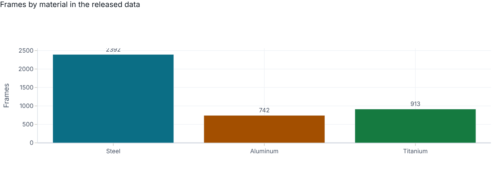

The authors' physical validation (repeated from the paper, not re-run here):

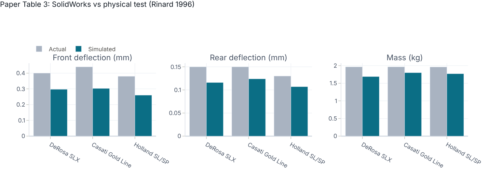

## 3. What was done (pipeline)

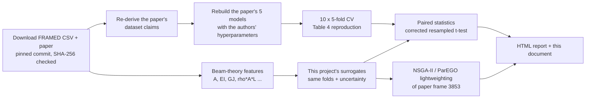

Stages map one-to-one onto `python -m src.framed.run --stage <name>`:
`fetch → stats → baselines → ours → optimize → report` (and `figures` for the PNGs here).

## 4. Results

### 4.1 The paper's dataset claims reproduce

All **11 of 11** checkable claims reproduce from the released file (counts within ±2 frames, case-study frames exact).
Two further rows are context only, because the paper counted 4,118 frames and 71 of those are not in the public release.

| Claim | Source | Paper | This study | Verdict |
|---|---|---|---|---|
| Frames failing both SF checks | authors' notebook | 1,966 | 1,967 | reproduced |
| Frames failing SF1 only | authors' notebook | 1,272 | 1,272 | reproduced |
| Frames failing SF3 only | authors' notebook | 182 | 182 | reproduced |
| Valid frames (both SF ≥ 1) | authors' notebook | 626 | 626 | reproduced |
| Non-dominated designs (5 objectives) | authors' notebook | 76 | 74 | reproduced (±2) |
| Frame 3853 mass / SF1 | paper Sec. 5.2 | 2.84 kg / 1.29 | 2.84 kg / 1.29 | reproduced |
| Frame 2108 mass / SF1 | paper Sec. 5.2 | 22.83 kg / 0.093 | 22.83 kg / 0.093 | reproduced |
| Frame 857 mass / SF1 | paper Sec. 5.2 | 1.60 kg / 2.416 | 1.60 kg / 2.416 | reproduced |
| Frames failing any SF check | paper Sec. 5.1 | 3,419 of 4,118 | 3,421 of 4,047 | context |

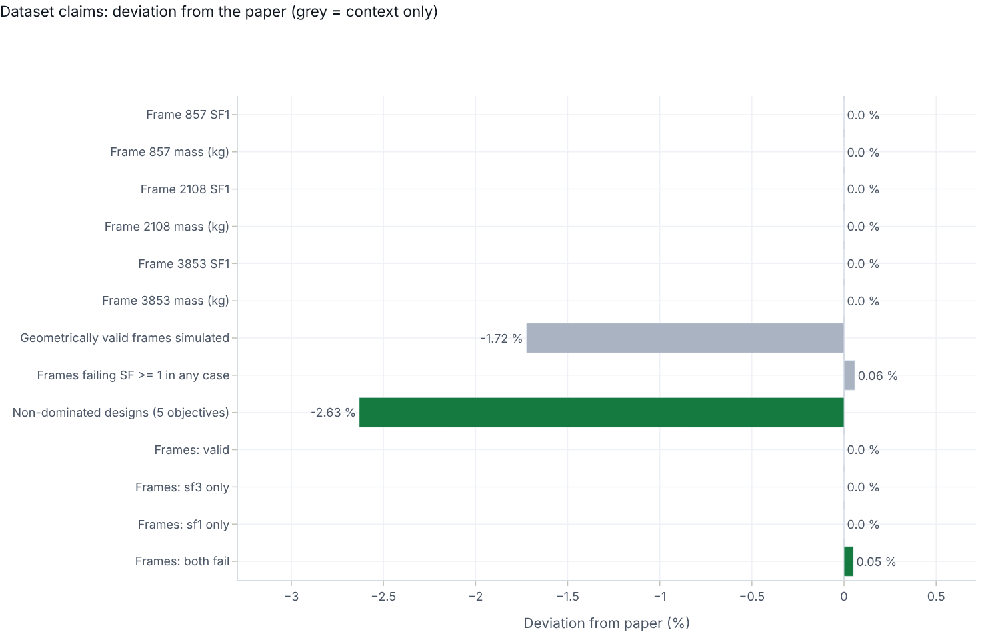

Performance space (cf. paper Fig. 6; units cm, deg, kg; cropped at the 99.5th percentile) and output correlations:

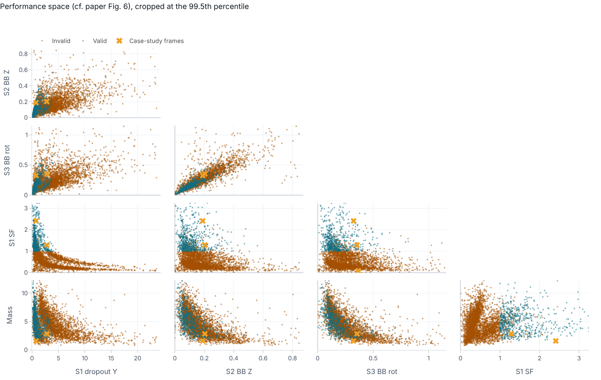
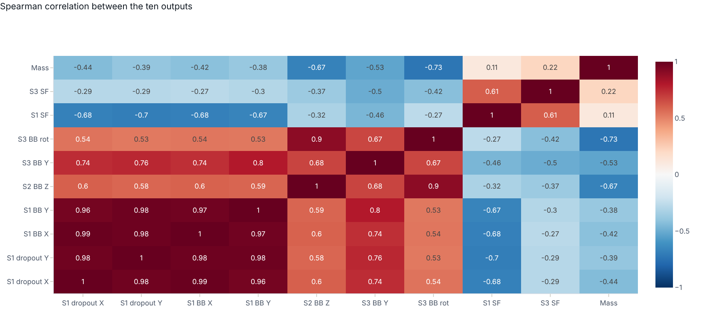

### 4.2 Paper Table 4, reproduced

The paper's five regressors were rebuilt with the authors' best hyperparameters (paper Tables 6–9) and scored with
10 repeats × 5-fold cross-validation (AutoGluon: 1 × 5 folds to bound run time). R², MAE and MSE are averaged over the
ten standardised outputs, as in the paper.

| Model | Paper R² | Reproduced R² (± std) | Paper MAE | Reproduced MAE | Paper MSE | Reproduced MSE | Folds |
|---|---|---|---|---|---|---|---|
| AutoML (AutoGluon) | 0.605 | **0.737** ± 0.044 | 0.182 | **0.182** | 0.995 | 0.336 | 5 |
| XGBoost | 0.595 | 0.691 ± 0.049 | 0.208 | 0.227 | 0.978 | 0.394 | 50 |
| Neural network | 0.545 | 0.592 ± 0.058 | 0.263 | 0.309 | 1.031 | 0.485 | 50 |
| Decision tree | 0.440 | 0.514 ± 0.046 | 0.297 | 0.338 | 1.156 | 0.566 | 50 |
| K-nearest neighbours | 0.306 | 0.378 ± 0.030 | 0.412 | 0.447 | 1.270 | 0.702 | 50 |

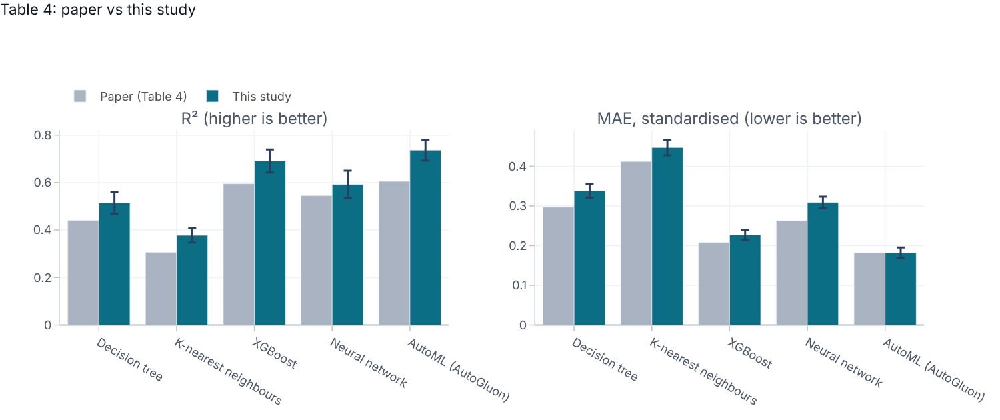

- **Ranking preserved:** AutoML > XGBoost > NN > decision tree > KNN, exactly as published.
- **MAE matches closely** (within 0.046; AutoML's 0.182 is identical to the paper's).
- **R² is 0.05–0.13 higher than published.** Two consistent explanations: the release lacks 71 of the paper's frames
  (plausibly the most extreme), and the paper's MSE values (≈1.0) are not consistent with unit-variance targets at its
  own R², which points to a different scaling or data version. The authors' AutoML training code is not public, so the
  protocol here is inferred (Section 5.1). These gaps are reported, not tuned away; the pass/fail rule (±0.05 on both R²
  and MAE) therefore marks only the neural network as "within tolerance".

Out-of-fold parity plot of the paper's best model, drawn with the same axes and units as paper Fig. 9:

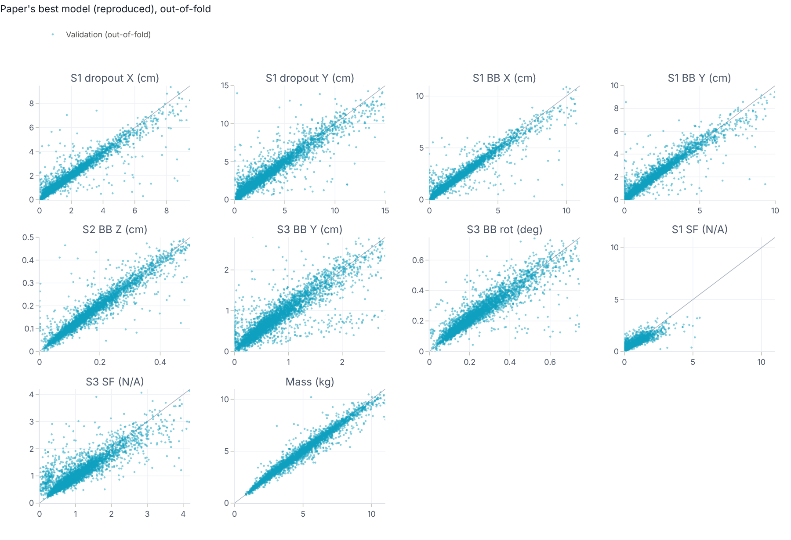

### 4.3 This project's models vs the paper's, on identical folds

| Model | Origin | R² (± std) | MAE (std.) | Folds | Wall time |
|---|---|---|---|---|---|
| **AutoGluon + physics** | this project | **0.747** ± 0.052 | **0.157** | 5 | 25 min |
| AutoML (AutoGluon) | paper, reproduced | 0.737 ± 0.044 | 0.182 | 5 | 24 min |
| **Deep ensemble + physics** | this project | **0.734** ± 0.048 | 0.189 | 50 | 5 min |
| Physics-guided MLP | this project | 0.717 ± 0.048 | 0.203 | 50 | 1 min |
| XGBoost + physics | this project | 0.705 ± 0.055 | 0.198 | 50 | 1 min |
| XGBoost | paper, reproduced | 0.691 ± 0.049 | 0.227 | 50 | 1 min |
| Gaussian process + physics | this project | 0.651 ± 0.084 | 0.236 | 50 | 17 min |
| Neural network | paper, reproduced | 0.592 ± 0.058 | 0.309 | 50 | 8 min |
| Decision tree | paper, reproduced | 0.514 ± 0.046 | 0.338 | 50 | 1 min |
| K-nearest neighbours | paper, reproduced | 0.378 ± 0.030 | 0.447 | 50 | < 1 min |

**Is the gain real?** Paired comparison of the best model (AutoGluon + physics) with each reproduced paper model,
Nadeau–Bengio corrected resampled t-test (accounts for overlapping training sets in repeated CV):

| Against | Mean Δ R² | Folds won | p (one-sided) | Verdict |
|---|---|---|---|---|
| AutoML (AutoGluon) | +0.010 | 4 / 5 | 0.15 | not significant |
| XGBoost | +0.057 | 5 / 5 | 0.0053 | better |
| Neural network | +0.153 | 5 / 5 | 0.0003 | better |
| Decision tree | +0.235 | 5 / 5 | 0.00003 | better |
| K-nearest neighbours | +0.371 | 5 / 5 | 0.00006 | better |

Reading: the physics features cut AutoGluon's MAE by 13 % (no significance test on MAE) and raise R² by 0.010, which is
not significant over 5 folds. The deep ensemble, a single model, matches the AutoML ensemble (0.734 vs 0.737) in a
fifth of the time and adds uncertainty intervals the paper's models do not have.

**Per-output accuracy (R² on standardised outputs):**

| Output | Paper AutoML (reproduced) | AutoGluon + physics | Deep ensemble + physics | Deep-ensemble 95 % coverage |
|---|---|---|---|---|
| Sim 1 dropout X | 0.802 | 0.823 | 0.783 | 0.973 |
| Sim 1 dropout Y | 0.626 | 0.663 | 0.660 | 0.973 |
| Sim 1 BB X | 0.863 | 0.871 | 0.832 | 0.975 |
| Sim 1 BB Y | 0.784 | 0.798 | 0.795 | 0.975 |
| Sim 2 BB Z | 0.736 | 0.702 | 0.736 | 0.984 |
| Sim 3 BB Y | 0.479 | 0.516 | 0.542 | 0.955 |
| Sim 3 BB rotation | 0.683 | 0.719 | 0.708 | 0.971 |
| Sim 1 safety factor | 0.738 | 0.715 | 0.674 | 0.961 |
| Sim 3 safety factor | 0.706 | 0.705 | 0.668 | 0.946 |
| Mass | 0.951 | 0.956 | 0.946 | 0.967 |

The physics features help most on deflections and rotation, where beam theory applies, and slightly hurt the safety
factors, whose FE labels include junction stress singularities (paper Sec. 3.5). The 95 % intervals are
**conservative**: they cover 94.6–98.4 % of held-out frames (the Gaussian process: 93.7–97.2 %).

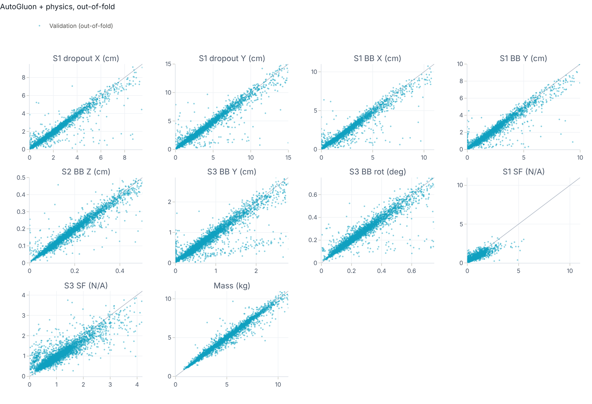
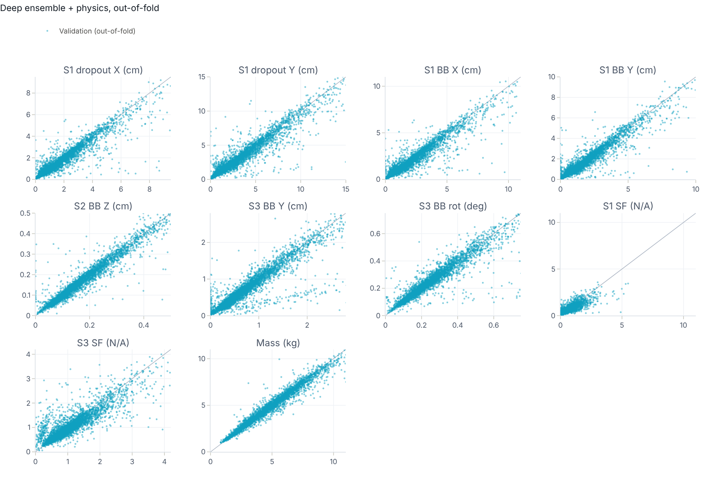

**Worst-case error and speed (CLAUDE.md metrics).** Max relative error over all folds is 144–12,071 % per output for
the deep ensemble (mass: 144 %); near-zero deflections and safety factors dominate the worst case, even with deflection
denominators floored at 5 % of the training median. A single-design prediction takes ≈ 29 ms (deep ensemble) against
1.9 ms for the analytic mass estimate, so it is 0.06× as fast as that baseline (which predicts mass only). Batch inference
takes 0.036 ms per design, ≈ 5 × 10⁶ × faster than a nominal 180 s production FE run (an assumed figure; the paper gives
no run time).

### 4.4 Lightweighting the paper's titanium frame (the paper's stated future work)

The paper's case-study titanium road frame (frame 3853) keeps its rider-fit geometry; NSGA-II (6,000 evaluations) and
ParEGO (150) vary the OD and wall thickness of the top, down and seat tubes and the stays (10 variables) to minimise
mass and in-plane dropout deflection, subject to SF1, SF3 ≥ 1, transverse deflection no worse than the reference, and
D/t ≤ 50. Each material runs twice: **nominal** (mean SF ≥ 1) and **robust** (SF ≥ 1 on the 95 % lower bound).

Important context: the surrogate predicts frame 3853 at 2.55 kg and SF 1.10 / 0.90, while FE gives 2.84 kg and
1.29 / 1.07. Both runs therefore treat the reference itself as infeasible, and **all changes below are relative to the
surrogate's own prediction**, not to FE. None of these designs was re-checked in FE.

| Run | Design | Mass (kg) | Δ mass | Dropout Y (mm) | Δ deflection | SF1 / SF3 mean (lower bound) |
|---|---|---|---|---|---|---|
| Ti nominal | reference (surrogate) | 2.55 | – | 27.8 | – | 1.10 (0.50) / 0.90 (0.40) |
| Ti nominal | lightest feasible | 1.95 | **−23.8 %** | 19.3 | **−30.5 %** | 1.21 (0.50) / 1.19 (0.52) |
| Ti nominal | knee | 3.51 | +37.6 % | 4.5 | −83.7 % | 2.09 (0.92) / 2.21 (0.95) |
| Ti robust | lightest feasible | 3.07 | +20.4 % | 5.4 | −80.5 % | 3.04 (1.34) / 2.35 (1.01) |
| Steel nominal | lightest feasible | 3.76 | −16.0 % | 3.9 | −68.1 % | 1.23 (0.55) / 1.00 (0.44) |
| Steel robust | lightest feasible | 11.01 | +145.8 % | 1.5 | −87.6 % | 2.65 (1.01) / 2.35 (1.00) |
| Al nominal | lightest feasible | 2.29 | +26.8 % | 6.4 | −83.1 % | 1.27 (0.56) / 1.00 (0.42) |
| Al robust | – | no feasible design in 6,150 evaluations | | | | |

Ti nominal lightest design (mm): TT 32.3 × 0.71, DT 46.9 × 1.32, ST 34.5 × 0.80, SS 14.2 × 0.50, CS 18.2 × 3.84
(OD × wall), against the reference's TT 28.6 × 1.11, DT 36.5 × 1.10, ST 31.8 × 8.67, SS 13.0 × 0.50, CS 23.4 × 2.03.
The mass saving comes mostly from the reference's very thick seat tube (8.67 mm wall).

The gap between the nominal and robust runs is the mass price of certainty: the surrogate's safety-factor intervals are
wide. Optimised designs sit 3.4–5.8 standardised units from the nearest simulated frame, against a typical
nearest-neighbour spacing of 2.9 inside FRAMED, so they are mild extrapolations.

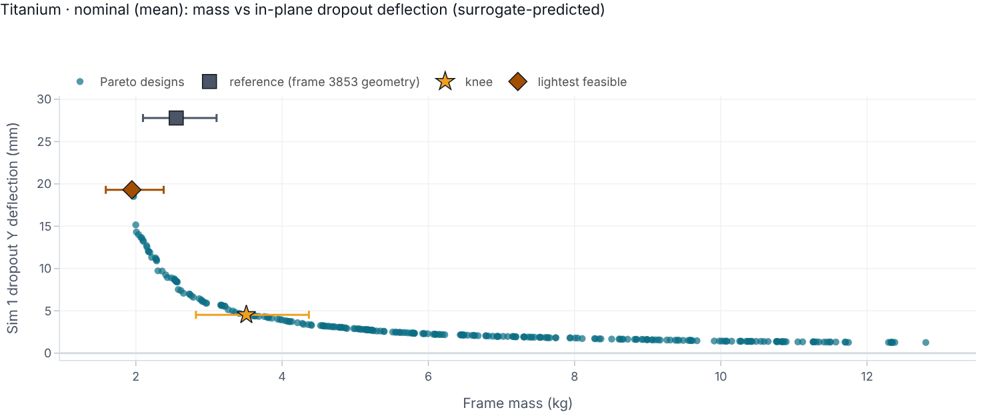
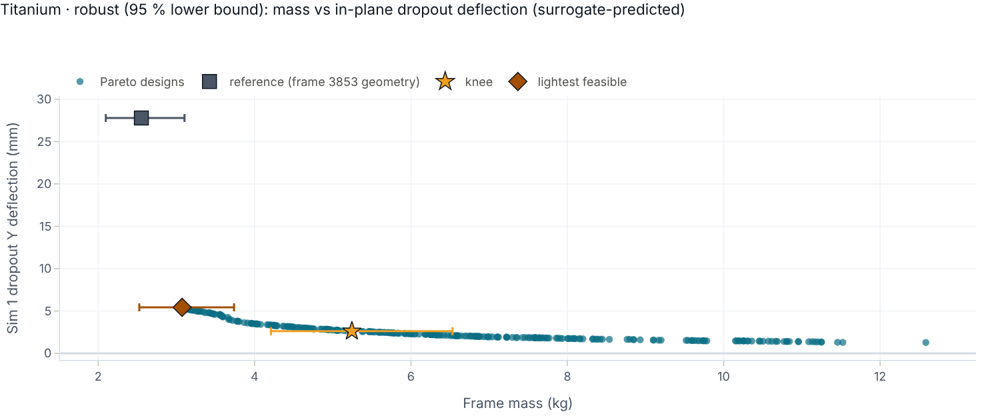

Steel and aluminium fronts: `docs/framed/img/12_*.png` to `14_*.png`.

## 5. Method details

### 5.1 Reproduction protocol (inferred)

- Preprocessing as in the authors' `Analysis.ipynb`: X = first 39 columns of `all_structural_data_oh.csv`; the 7
  deflection/rotation columns and mass take absolute values.
- Per training fold: `StandardScaler` on X and on Y (fitted on the training part only, no leakage).
- Metrics: uniform mean over the 10 standardised outputs of R², MSE, MAE (sklearn).
- Folds: `KFold(5, shuffle=True)` with seeds 42…51 → 50 folds; AutoGluon on the first 5 (repeat 1).
- Hyperparameters exactly as the paper's Tables 6–9:
  - Decision tree: depth 7, absolute error, split 5, leaf 11, 32 features.
  - KNN: k = 70, distance weights.
  - XGBoost: depth 6, λ 72.41, η 0.276, γ 0.060, min child weight 4.82, early stop 8.
  - NN: 1 × 92 ReLU, dropout 0.579, lr 7.2e-5, batch 135, patience 44.
  - AutoGluon 1.6.3 `medium_quality`, 90 s per output per fold.

### 5.2 This project's surrogates

- **Beam-theory features** (`src/framed/physics_features.py`), from each tube's OD D and wall t:
  - area A = π/4 (D² − (D−2t)²) and second moment I = π/64 (D⁴ − (D−2t)⁴), with t ≥ D/2 treated as a solid rod;
  - log(E·I) and log(G·J), with E, G, ρ, σy from paper Table 2;
  - slenderness L/D;
  - an analytic mass estimate Σ ρ·A·L, which correlates with FE mass at r = 0.88 (top tube and seat stays have no length
    parameter and are left out).
- **Targets** modelled as log(y + ε), with ε = 1 % of the training median.
- **Guardrails**: mass > 0, deflections ≥ 0, safety factor ∈ [0, 20], finite outputs; inputs clipped to the training
  range and flagged.
- **Models**:
  - XGBoost (the paper's hyperparameters);
  - a 5-member deep ensemble (3 × 128 SiLU), whose uncertainty adds member spread and the held-out residual variance;
  - a physics-guided MLP, which learns log(mass / analytic mass);
  - a Gaussian process (ARD Matérn 5/2, 12 most-correlated features, kernel fitted on 400 rows);
  - AutoGluon on the same features.

### 5.3 Statistics

Paired comparisons use the Nadeau–Bengio corrected resampled t-test (test/train ratio 0.25), one-sided. A plain
Wilcoxon test on overlapping folds overstates significance (caught in code review). Differences to published Table 4
values are descriptive only.

### 5.4 Optimisation

`src/framed/optimize.py` defines `FramedProblem`, which plugs into the V1 optimisers in `src/optimizer.py` (NSGA-II,
ParEGO, Pareto filter, knee point). Variable bounds are the dataset's 1st–99th percentiles, widened to include the
reference frame.

## 6. Limitations and honest caveats

- **A bicycle, not a motorcycle.** FRAMED is the closest public, peer-reviewed, tube-parametric two-wheeler dataset.
- **Inferred protocol, different data version.** The release has 4,047 frames against the paper's 4,118, and the
  paper's MSE is inconsistent with its R².
- **Noisy safety-factor labels.** They come from solid meshes with junction singularities, per the paper itself.
- **Surrogate-only optimisation.** There was no FE re-check (out of scope), and the surrogate under-predicts frame
  3853's mass by 10 %.
- **Few folds for AutoGluon.** It ran on 5 folds only, so its comparisons have low statistical power.
- **Conservative intervals.** The uncertainty intervals over-cover slightly.

## 7. Train it on your own machine (Windows)

**Hardware used for the published numbers:** 4-core Intel Xeon 2.1 GHz, 16 GB RAM, CPU only.
- Full run: about 1.5 h, of which AutoGluon is about 50 min.
- `--fast` run: under 15 min.
- Any recent 4+ core laptop with 8 GB RAM is enough, and a GPU is not needed.

**1. Get the code (includes the dataset and results).**
```powershell
git clone -b claude/optimistic-meitner-vvd4ne https://github.com/AlfredChettiar/structural-surrogate-optimizer
cd structural-surrogate-optimizer
```

**2. Create the main environment** (Python 3.13 or 3.14; Windows 10/11 is tested in CI on every pull request, see `.github/workflows/windows-ci.yml`).
```powershell
py -m venv .venv
.\.venv\Scripts\python.exe -m pip install --upgrade pip
.\.venv\Scripts\python.exe -m pip install -r requirements.txt xgboost psutil PyMuPDF
```

**3. (Optional) AutoGluon, the paper's AutoML.** It lives in its own environment because it pins older library
versions. The code finds it automatically at `.venv-ag\Scripts\python.exe`; if it is missing, AutoGluon rows show
"not run" and everything else still works.
```powershell
py -m venv .venv-ag
.\.venv-ag\Scripts\python.exe -m pip install "autogluon.tabular[all]"
```

**4. Check the install.**
```powershell
.\.venv\Scripts\python.exe -m pytest tests/test_framed.py -m "not slow"
```

**5. Run everything** (each stage writes `models/framed/<stage>.json`; stages can be re-run individually):
```powershell
.\.venv\Scripts\python.exe -m src.framed.run --stage all          # add --fast for 1 x 5 folds
# or step by step:
.\.venv\Scripts\python.exe -m src.framed.run --stage fetch        # verifies / downloads the CSV (SHA-256)
.\.venv\Scripts\python.exe -m src.framed.run --stage stats        # paper dataset claims
.\.venv\Scripts\python.exe -m src.framed.run --stage baselines    # paper Table 4 models
.\.venv\Scripts\python.exe -m src.framed.run --stage ours         # this project's models
.\.venv\Scripts\python.exe -m src.framed.run --stage optimize     # lightweighting study
.\.venv\Scripts\python.exe -m src.framed.run --stage report       # reports/framed/index.html
# equivalently: powershell -ExecutionPolicy Bypass -File .\run_pipeline.ps1 -Framed [-Fast]
```
- **Run only some models:** `--models xgboost,knn` (results merge into the existing JSON).
- **Skip AutoGluon:** list the other models explicitly, e.g. `--stage ours --models deep_ensemble_phys,pg_mlp,xgboost_phys,gp_phys`.

**6. Figures for this document** (optional; needs `pip install kaleido` and Chrome or Edge installed):
```powershell
.\.venv\Scripts\python.exe -m pip install kaleido
.\.venv\Scripts\python.exe -m src.framed.run --stage figures      # docs/framed/img/*.png
```

**7. Look at the results.**
- Open `reports/framed/index.html` in a browser; it needs internet for the fonts and charts.
- Or run `.\.venv\Scripts\python.exe -m streamlit run app.py` and open tab 5.

**Troubleshooting**
- **Out of memory:** lower the parallel workers with `N_JOBS` in `src/framed/config.py`.
- **AutoGluon is slow:** lower `TIME_LIMIT_S` in `src/framed/automl.py`.
- **Checksum error in `fetch`:** the CSV was modified. Delete it and run `--stage fetch` again.

## 8. Data format, and training on your own data

The loader (`src/framed/data.py::load_framed`) reads a CSV with:

- **Column 0:** a row index (frame ID).
- **Columns 1–39: the inputs, in exactly this order.** Lengths are in metres, angles in degrees, and material and bridge
  flags are 0/1.

| # | Column | Unit | Range in FRAMED (min / median / max) |
|---|---|---|---|
| 1–3 | `Material=Steel`, `Material=Aluminum`, `Material=Titanium` | one-hot | exactly one is 1 |
| 4–5 | `SSB_Include`, `CSB_Include` | 0/1 | seat-/chain-stay bridge present |
| 6 | `CS Length` | m | 0.200 / 0.407 / 2.0 |
| 7 | `BB Drop` | m | −0.665 / 0.065 / 0.606 |
| 8 | `Stack` | m | 0.280 / 0.566 / 0.794 |
| 9 | `SS E` | m | 0.005 / 0.045 / 0.43 |
| 10 | `ST Angle` | deg | 16 / 73.5 / 120 |
| 11–17 | `BB OD`, `TT OD`, `HT OD`, `DT OD`, `CS OD`, `SS OD`, `ST OD` | m | e.g. TT 0.0127 / 0.0286 / 0.13 |
| 18 | `CS F` | m | 0.001 / 0.015 / 0.03 |
| 19–21 | `HT LX`, `ST UX`, `HT UX` | m | head-tube lower / seat-tube upper / head-tube upper extensions |
| 22 | `HT Angle` | deg | 30 / 72.5 / 85.5 |
| 23–25 | `HT Length`, `ST Length`, `BB Length` | m | e.g. ST 0.055 / 0.529 / 0.9 |
| 26 | `Dropout Offset` | m | 0.109 / 0.130 / 0.256 |
| 27–28 | `SSB OD`, `CSB OD` | m | bridge diameters |
| 29–30 | `SSB Offset`, `CSB Offset` | m | bridge positions |
| 31 | `SS Z` | m | 0.00075 / 0.009 / 0.0254 |
| 32–38 | `SS/CS/TT/BB/HT/ST/DT Thickness` | m | 0.0005 / ≈0.0022 / 0.01 |
| 39 | `DT Length` | m | 0.339 / 0.652 / 2.16 |

**The 10 outputs**, matched by name, in any position after the inputs. Deflection signs don't matter, because the
loader takes absolute values.

| Column | Unit | Load case |
|---|---|---|
| `Sim 1 Dropout X Disp.`, `Sim 1 Dropout Y Disp.`, `Sim 1 Bottom Bracket X Disp.`, `Sim 1 Bottom Bracket Y Disp.` | m | in-plane |
| `Sim 2 Bottom Bracket Z Disp.` | m | transverse |
| `Sim 3 Bottom Bracket Y Disp.` | m | eccentric |
| `Sim 3 Bottom Bracket X Rot.` | rad | eccentric |
| `Sim 1 Safety Factor`, `Sim 3 Safety Factor` | – | in-plane, eccentric |
| `Model Mass` | kg | – |

**To train on your own file** (for example, frames you solved in your own FE tool with the same load cases), point the
pipeline at it:
```powershell
$env:FRAMED_CSV = "C:\path\to\my_frames.csv"
.\.venv\Scripts\python.exe -m src.framed.run --stage baselines
.\.venv\Scripts\python.exe -m src.framed.run --stage ours
.\.venv\Scripts\python.exe -m src.framed.run --stage report
```
Notes:
- The loader rejects files without 39 inputs and all 10 outputs.
- Paper-specific checks (`--stage stats`, the case-study tests and the optimisation reference frame 3853) only make
  sense on the FRAMED file. Skip them, or change `REF_INDEX` in `src/framed/optimize.py` to a frame in your data.
- Use the same units (metres, radians, kg). The physics features assume the Table 2 materials, so for a new material add
  it to `MATERIALS` in `paper_reference.py` and to `config.MATERIALS`.
- Several hundred designs are the practical minimum; FRAMED has 4,047.
- To use a model in your own code:
  ```python
  from src.framed.data import load_framed
  from src.framed.surrogates import our_models
  X, Y = load_framed()                                   # or load_framed("my_frames.csv")
  model = our_models()["deep_ensemble_phys"]().fit(X, Y.values)
  lo, mean, hi = model.predict_interval(X.head(3))       # 95 % interval, physical units (m, rad, kg)
  ```

## 9. File inventory

| Path | What it is |
|---|---|
| `src/framed/config.py` | Paths, pinned data URL/commit/SHA-256, column lists, units |
| `src/framed/paper_reference.py` | Every number taken from the paper, with its location (single source for comparisons) |
| `src/framed/data.py` | Download + checksum, loader (`FRAMED_CSV` override), fold indices |
| `src/framed/paper_stats.py` | Feasibility counts, non-dominated set, claim comparison table |
| `src/framed/baselines.py` | Paper models with the authors' hyperparameters, CV protocol, metrics, Table 4 reproduction |
| `src/framed/physics_features.py` | Tube section properties, materials, analytic mass estimate |
| `src/framed/surrogates.py` | This project's models, transforms, guardrails, uncertainty, latency |
| `src/framed/automl.py`, `automl_runner.py` | AutoGluon wrapper (runs in `.venv-ag` through a subprocess) |
| `src/framed/optimize.py` | `FramedProblem` for the V1 optimisers, nominal/robust studies |
| `src/framed/figures.py` | Plotly figures (portfolio palette) |
| `src/framed/report.py` | HTML report + Markdown summary |
| `src/framed/run.py` | Command-line pipeline (`--stage …`) |
| `tests/test_framed.py` | 34 tests (2 marked `slow`) |
| `data/external/framed/all_structural_data_oh.csv` + `LICENSE` | FRAMED dataset (MIT, © 2022 Lyleregenwetter), 4,047 × 50 |
| `data/framed_pareto.csv` | All Pareto designs from the optimisation |
| `models/framed/*.json` | Results: `env`, `stats`, `reproduction`, `ours`, `optimize` |
| `models/framed/*_oof.npz` | Out-of-fold predictions (for parity plots) |
| `reports/framed/index.html`, `reports/framed_benchmark.md` | Interactive report and its Markdown twin |
| `docs/framed/img/*.png` | Figures in this document |
| `docs/superpowers/plans/2026-11-25-framed-benchmark.md` | Implementation plan with all design decisions |
| `PRODUCT.md`, `.impeccable/surfaces/framed-report.md` | Report design brief (impeccable) |
| `app.py` (tab 5) | Streamlit view of the results |

The paper PDF is **not** committed (its copyright is not MIT); `--stage fetch` downloads it locally.

## 10. References

1. L. Regenwetter, C. Weaver, F. Ahmed, "FRAMED: An AutoML Approach for Structural Performance Prediction of Bicycle
   Frames", *Computer-Aided Design*, Elsevier, 2023. arXiv:2201.10459.
2. L. Regenwetter et al., FRAMED dataset and code, MIT licence, © 2022 Lyleregenwetter.
   https://github.com/Lyleregenwetter/FRAMED
3. L. Regenwetter, B. Curry, F. Ahmed, "BIKED: A Dataset for Computational Bicycle Design with Machine Learning
   Benchmarks", *Journal of Mechanical Design*, 2022 (the source of FRAMED's designs).
4. D. Rinard, "Frame Deflection Test", 1996 (the physical tests used in paper Table 3).
5. C. Nadeau, Y. Bengio, "Inference for the Generalization Error", *Machine Learning* 52, 2003.
6. N. Erickson et al., "AutoGluon-Tabular: Robust and Accurate AutoML for Structured Data", arXiv:2003.06505, 2020.
7. K. Deb et al., "A fast and elitist multiobjective genetic algorithm: NSGA-II", *IEEE Trans. Evol. Comput.* 6(2), 2002.
8. J. Knowles, "ParEGO: a hybrid algorithm with on-line landscape approximation for expensive multiobjective
   optimization problems", *IEEE Trans. Evol. Comput.* 10(1), 2006.
